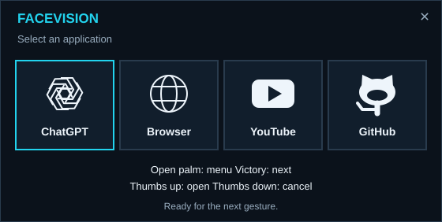
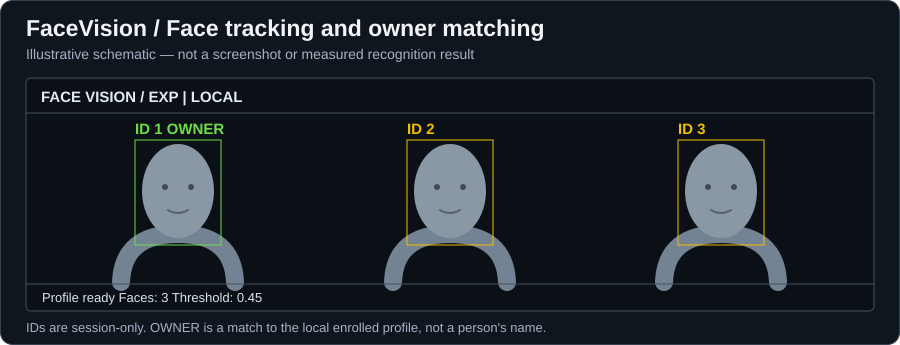
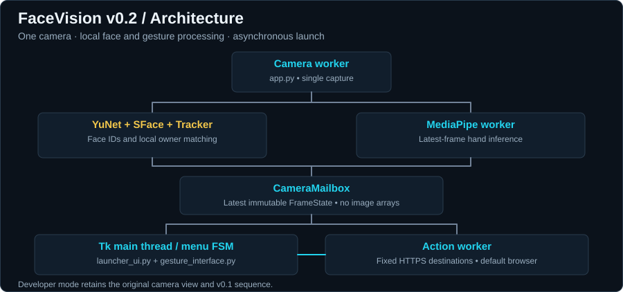
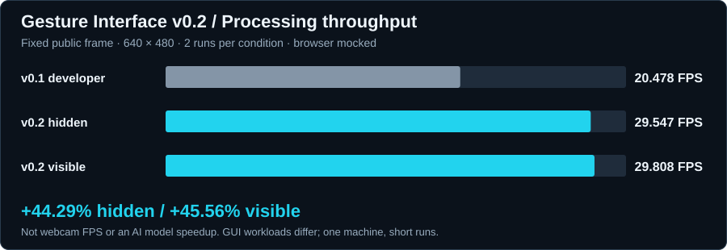

# FaceVision — Gesture Interface v0.2

Real-time computer vision and touchless computer interaction on consumer hardware. FaceVision combines local face detection, owner verification, temporary face tracking and hand gestures with a compact application launcher.



*Source-grounded schematic of the actual Tkinter layout, not a camera screenshot.*

## What's new in v0.2

- Open a four-application menu with an open palm; navigate with Victory, confirm with thumbs up, cancel with thumbs down.
- ChatGPT, Browser (Google), YouTube and GitHub are the only launch destinations.
- One camera, local CPU inference, background processing and a visible camera-status window.
- The developer view retains the earlier face tracking, owner matching and seven gesture labels, plus the v0.1 sequence experiment.
- Stable gesture confirmation, same-hand tracking, ambiguity and stale-input rejection, neutral release, inactivity timeout and cooldown.
- 82 tests passed in the supplied Windows validation; 51 pure-logic tests independently rerun during publication. No new AI model or dependency.

## Quick start

Windows 10, Python 3.11 x64 with Tkinter, a webcam, and the pinned requirements. Tested originally on a Ryzen 5 3500X with 16 GB RAM and a Redragon Full HD webcam.

1. Clone or download this repository.
2. Fetch the third-party models (verified SHA-256 downloads):

   ```bat
   py -3.11 fetch_models.py
   ```

3. Double-click **START.bat**. The launcher creates an isolated virtual environment and installs the pinned dependencies. Initial setup requires internet; inference runs locally.

| Gesture | Action |
|---|---|
| Open palm | Show the menu, ChatGPT selected |
| Victory | Select next application |
| Thumbs up | Open selected application |
| Thumbs down | Cancel menu |

Hold a gesture for about half a second. Relax your hand between repeated Victory gestures and wait for **Ready for the next gesture**. Keep the same hand visible. Holding Victory does not repeatedly cycle. The menu closes on inactivity (10 seconds) or unreliable tracking. After launching, a 5-second cooldown requires a fresh activation. **Exit** or native close stops the camera. **Ctrl+Q** exits when focused; **Esc** cancels; **G** toggles hand processing.

## Developer mode and face recognition

```bat
START.bat --developer
START.bat --developer --no-gesture-language
```

In developer mode, E enrolls your own face, X erases the local profile, Esc cancels enrollment, and Q exits. The first command retains the v0.1 sequence experiment; the second disables sequence actions. Launcher mode never instantiates the old sequence recognizer.



*Illustrative face tracking and owner matching, not an actual recognition test.*


*Gesture class schematic; the original developer view draws boxes and text, not skeletons.*

The local owner profile is stored in `data/owner.npy`. Never upload it. Other faces receive temporary session IDs. Owner recognition and hand commands are separate features; commands are not restricted to the owner's hand.

## Architecture



| Module | Role |
|---|---|
| `app.py` | Single camera engine; developer view or background processing |
| `face_vision.py`, `tracking.py` | YuNet/SFace, local enrollment and temporary IDs |
| `gestures.py` | Independent MediaPipe inference and hand continuity |
| `gesture_interface.py` | Menu state machine and fixed-URL asynchronous launcher |
| `launcher_ui.py` | Tk main thread, status window and compact menu |
| `gesture_language.py` | Earlier v0.1 sequence experiment |
| `metrics.py`, benchmark scripts | Performance instrumentation |

Configuration:

```bat
START.bat --gesture-hold-ms 300 --menu-timeout 10 --launch-cooldown 5
START.bat --size 1280x720
START.bat --camera 1
START.bat --no-gestures
```

## Tests and performance



| Condition | Median processing FPS |
|---|---:|
| v0.1 developer view | 20.478 |
| v0.2 hidden menu | 29.547 |
| v0.2 visible menu | 29.808 |

Controlled replay of identical public pixels, real models and GUI loops, mocked browser, two 15-second measurements per condition after 3-second warmups. The observed throughput differences (+44.29% hidden / +45.56% visible) reflect different GUI workloads, not improved model inference or guaranteed webcam FPS. The baseline runs varied substantially.

```bat
.venv\Scripts\python.exe -m unittest checks test_gestures test_gesture_language test_language_integration test_gesture_interface test_launcher_ui test_interface_engine -v
.venv\Scripts\python.exe -m pip check
```

The replay benchmark accepts `--baseline-source` and `--fixture`. The original exact local v0.1 backup and public fixture are not bundled with this repository; see the report for details. Create the workspace backup directory before running the interface benchmark.

- [Technical report](docs/GESTURE_INTERFACE_v0.2_REPORT.md)
- [Public benchmark and validation summary](benchmarks/gesture_interface_v0.2_summary.json)
- [Historical gesture-recognition A/B data](benchmarks/gesture_ab_summary.json)

## Limitations and privacy

Research and educational prototype, not an authentication or security product. No anti-spoofing/liveness model. Photos or statues may trigger face detections; occlusion may disrupt tracking. Command hand association is geometric, not biometric. The app does not save camera images. The final Google URL and English UI were tested in isolation/automated tests, but not in another full user-camera session. No original webcam captures, private profile vectors, local logs or model binaries are published.

## Credits

Project direction, requirements and hands-on testing by the repository owner; implementation developed with AI assistance. YuNet, SFace, OpenCV and MediaPipe are existing third-party technologies. See [THIRD_PARTY.md](THIRD_PARTY.md). No project-wide open-source license has been selected.

Official references: [Python webbrowser](https://docs.python.org/3.11/library/webbrowser.html), [Tkinter threading model](https://docs.python.org/3.11/library/tkinter.html#threading-model).
