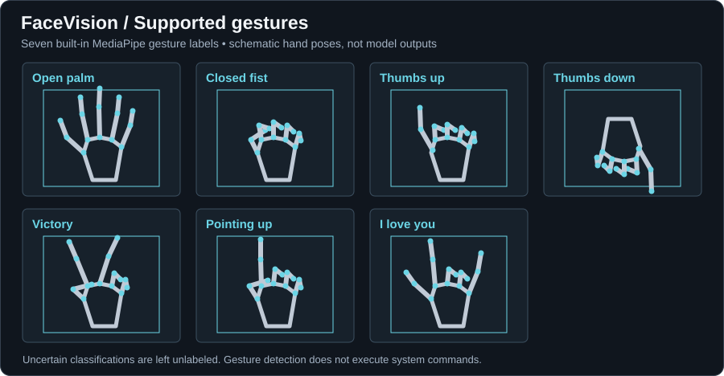
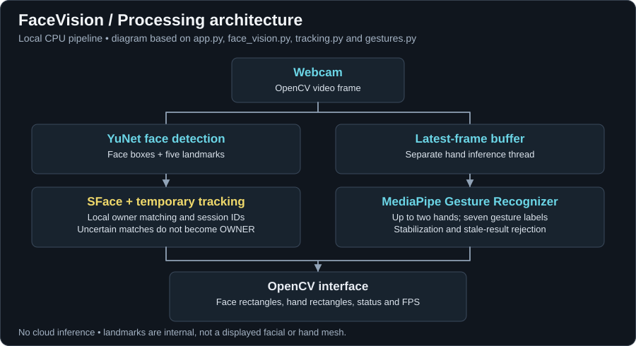
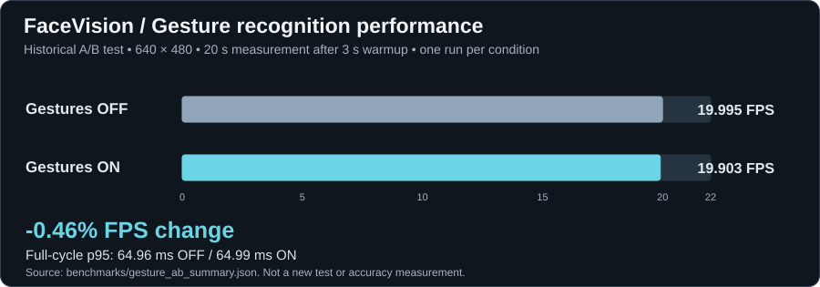

# FaceVision

Real-time facial recognition, multi-face tracking and hand gesture recognition on consumer hardware. A personal computer vision prototype developed with AI-assisted software engineering, hands-on testing and iterative performance evaluation.

## Visual overview


*Illustrative schematic of the interface and label logic, not a screenshot or a recognition test.*



*Illustrative hand poses for the seven built-in gesture classes. The application draws bounding boxes and text, not hand skeletons.*

## Features

- YuNet face detection and SFace matching against a voluntarily enrolled owner profile.
- Temporary numerical tracking IDs; no persistent database of other faces.
- MediaPipe Gesture Recognizer: up to two hands, 21 landmarks per hand, seven predefined gesture classes.
- Independent gesture inference thread with a latest-frame buffer and stale-result rejection.
- Local CPU inference, one webcam, minimal OpenCV interface.

Supported gestures: open palm, closed fist, thumbs up/down, victory, pointing up and I love you. Uncertain gestures are left unclassified. Gestures do not execute system commands.

## Setup

Tested configuration in the supplied project records: Windows 10, Python 3.11 x64, Ryzen 5 3500X, 16 GB RAM, Redragon Full HD webcam, CPU inference. The initial installation requires internet; subsequent inference is local.

1. Install Python 3.11 x64 with the Windows Python launcher.
2. Open a terminal in the repository directory. Download the exact original third-party model weights:

   ```powershell
   py -3.11 fetch_models.py
   ```

3. Double-click `START.bat` (or run `.\START.bat` from PowerShell). The launcher creates an isolated environment and installs pinned dependencies. Default camera request: 640 x 480.

| Key | Action |
| --- | --- |
| E | Enroll your own face (one person in frame) |
| X | Delete local owner profile |
| Esc | Cancel enrollment, or exit when not enrolling |
| G | Toggle hand gesture recognition |
| Q | Quit |

The owner profile is stored only locally under `data/owner.npy`. Do not upload this file. Other faces receive session-only tracking IDs. Enroll only with explicit consent.

## Architecture



- `app.py`: camera, recognition pipeline and rendering
- `face_vision.py`: YuNet/SFace, profile storage, model integrity checks
- `tracking.py`: temporary tracks, enrollment and identity decisions
- `gestures.py`: independent hand/gesture inference and temporal stabilization
- `metrics.py`, `benchmark_gestures.py`: performance instrumentation
- `checks.py`, `test_gestures.py`: automated checks

After installation, run:

```powershell
.\.venv\Scripts\python.exe -m unittest checks test_gestures -v
```

## Measured prototype performance



The supplied local test report dated 27 November 2026 records a single short A/B run per configuration, with 3 seconds of warmup and 20 seconds of measurement at 640 x 480:

| Gesture recognition | Completed FPS | Full-cycle p95 |
| --- | ---: | ---: |
| Off | 19.995 | 64.96 ms |
| On | 19.903 | 64.99 ms |

The measured FPS difference was -0.46%; 258 processed frames included an OWNER match and both hands in the enabled run. The report records 15/15 passing automated checks. See `benchmarks/gesture_ab_summary.json` for the aggregate results. These are historical results, not newly verified by the publication preparation. They do not establish accuracy across people, environments or gestures, nor do they establish 30 FPS or 3 m recognition.

## Limitations and intended use

Research and educational prototype; **not a security or authentication product**. No passive liveness/anti-spoofing: photographs, screens and statues can trigger face detections or identity matches. Tracking can fail or swap IDs during occlusion. Lighting, pose, distance and camera resolution affect recognition. Use only with informed participants and avoid surveillance or collection of other people's biometric data. No personal enrollment vectors, original webcam captures or model binaries are distributed here. Documentation graphics are illustrative unless explicitly identified as measured data.

## Credits and licensing

Project direction, hands-on evaluation and requirements by the repository owner; implementation developed with AI assistance. YuNet, SFace and MediaPipe are third-party technologies, not original models created for this project. See [THIRD_PARTY.md](THIRD_PARTY.md). No project-wide open-source license has been selected yet.
